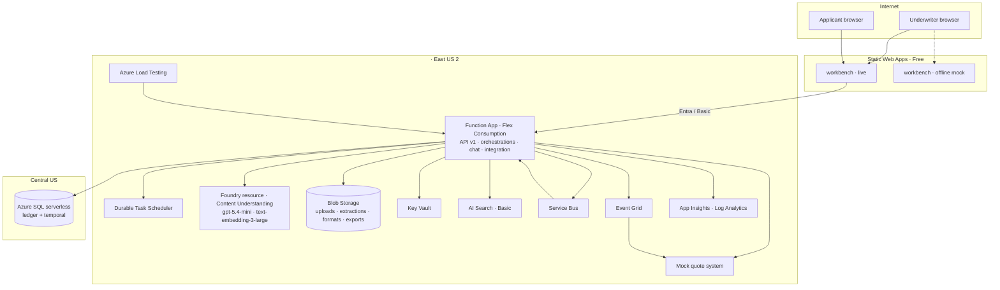
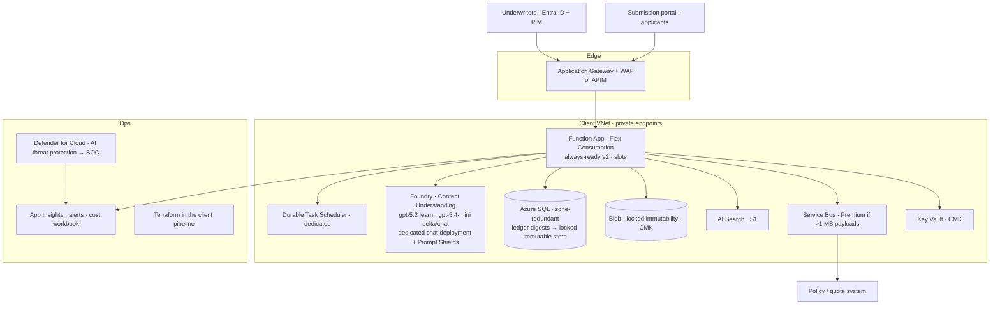

# Architecture overview — demo environment and production recommendation

Audience: the POC's stakeholders and the Azure architect of record. Everything in the "demo" column is deployed and measured (ADR 0001; ADR 0014); the "production" column is the recommendation for the client's own tenant and is not built.

## 1. How a loss run flows through the system

```mermaid
flowchart LR
  A[Applicant or underwriter uploads<br/>PDF · scan · XLSX · CSV · ZIP] --> B[Static Web App<br/>React workbench]
  B -->|HTTPS + Entra token| C[Function App · Durable Functions<br/>.NET 10 isolated · Flex Consumption]
  C --> D[Preprocess<br/>sniff · unlock · parse spreadsheets natively]
  D -->|PDF / image| E[Content Understanding<br/>classify & split bundles · layout with polygons]
  D -->|XLSX / CSV| F[Native parse · $0 · cell lineage]
  E --> G{Format memory}
  F --> G
  G -->|fingerprint hit| H[Deterministic replay<br/>0 model calls · ms]
  G -->|unmapped headers| I[Delta repair<br/>gpt-5.4-mini · 1 call]
  G -->|new carrier| J[Learn format<br/>gpt-5.4-mini · verify vs printed totals · lint]
  H --> K[Rule catalog R-01…R-26<br/>reconcile to printed totals]
  I --> K
  J --> K
  K -->|pass| L[(Azure SQL<br/>claims · lineage · ledger audit)]
  K -->|hard failure| M[Review queue<br/>human decision · override · audit]
  M --> L
  L --> N[Analytics engine<br/>41-metric catalog · what-if]
  L --> O[AI Search index<br/>pages & sheets · scoped chat]
  N --> P[Quote payload v2 · pricing memo]
  P --> Q[Service Bus outbox → quote system<br/>Event Grid notifications]
```

Every billable call writes a `UsageEvent`; every mutation writes an append-only audit event; every extracted value carries page+polygon or sheet+cell lineage and a format version.

## 2. Services: what the demo uses, what production should use

| Capability | Demo (deployed, POC subscription) | Production recommendation (client tenant) | Why it changes |
|---|---|---|---|
| Document layout, classification, bundle split | **Azure AI Content Understanding** (GA 2025-11-01) on a Foundry resource `<ai-resource>`, East US 2; inline (preview) analyze on the demo host for ≤5-page PDFs | Same, GA async API only; East US 2 (or the client's primary region) + a paired region; Private Link; customer-managed keys where supported | Preview inline API gives 1.3 s demo latency but has no SLA |
| Learn / delta / classification model | **gpt-5.4-mini**, Data Zone Standard, 100 K TPM; learn cap 1 (ADR 0004) | gpt-5.2 Data Zone Standard for learn (quality on dense scans), gpt-5.4-mini for delta/classification/chat; 300 K TPM; learn cap 3; model names as configuration with a retirement calendar | Personal-subscription risk check blocked gpt-5.2; enterprise quota removes that |
| Embeddings (format fingerprint, chat index) | text-embedding-3-large, Data Zone | Same | — |
| Second-opinion OCR | Document Intelligence (flag off; measured no benefit) | Keep available for air-gapped container scenarios only | — |
| Orchestration | **Durable Functions** on **Durable Task Scheduler** (consumption), Flex Consumption plan; always-ready 1 in demo mode | Same, dedicated DTS SKU, always-ready ≥2, deployment slots, zone redundancy | Cold start 15 s otherwise |
| System of record | **Azure SQL** serverless GP 0.5–2 vCore, Central US (ADR 0003: East US 2 refused on this subscription); ledger tables + temporal; Liquibase-format scripts | Azure SQL GP/Business Critical in the app region, zone-redundant, ledger digests to a **locked** immutable container (7-year retention), geo-backup | Cross-region adds ~50 ms per round trip today |
| Documents and raw extraction | **Blob Storage**, versioning, immutability on originals (unlocked, 1 day) | Same with locked immutability policy per retention schedule, Private Endpoint, CMK | — |
| Search / chat | **AI Search Basic** (semantic ranker), Agent Framework agent with scope enforced in tools; shared model deployment; Prompt Shields policy defined, not attached (ADR 0013) | AI Search Standard S1, dedicated chat deployment with Prompt Shields attached, Defender for AI alerts routed to the SOC | Dedicated deployment blocked on the POC subscription |
| Integration | **Service Bus** (sessions, duplicate detection, DLQ) + transactional outbox; **Event Grid** CloudEvents; mock quote system | Same pattern against the real policy/quote system (Guidewire-shaped adapter), APIM in front of the API | — |
| Web | **Static Web Apps** Free; browser calls the API directly; Basic auth demo mode or Entra | SWA Standard or App Service behind **APIM / Application Gateway + WAF**, Entra ID app roles only, Private Endpoints | Free tier cannot link a backend (ADR 0012) |
| Identity & secrets | Managed identities everywhere; Key Vault; no keys in app settings | Same + Entra PIM for admin roles, Conditional Access | — |
| Observability | Application Insights + Log Analytics; Azure Load Testing for performance evidence | Same + alert rules (DLQ depth, learn failures, drift rate, 429s), workbook for cost per document | — |
| Security posture | Defender for Cloud AI threat protection enabled; CORS restricted to SWA origins; modified abuse monitoring **not** available on the POC subscription | Modified abuse monitoring via the client's Microsoft account team; SOC 2 / ISO 27001 inherited from Azure; private networking end to end | Eligibility is per subscription |
| Cost tracking | Every call metered; daily Cost Management export; reconciliation (`docs/poc-plan/closeout/README.md`) | Same; tags per environment; budget alerts | — |
| Infrastructure as code | **Terraform** (azurerm 4.x, azapi), remote state in Azure Storage | Same, in the client's pipeline (Azure DevOps/GitHub) with environment promotion | — |

## 3. Demo topology

Standing cost of the demo environment: about $80/month with AI Search Basic on, under $5/month with it off; per-document cost $0.005–0.03 (see `docs/poc-plan/tco.md` after the close-out work).

## 4. Production topology (recommended)

What does **not** change between demo and production: the code, the Terraform modules, the schema scripts, the format registry, the rule catalog, the analytics catalog, and the measured numbers' method. What changes is quota, networking, retention locks, the learn model, and who owns the subscription.

## 5. Open items that need the client, not the POC

- Quota for gpt-5.2 Data Zone and a dedicated chat deployment (enterprise subscription; no risk-check block).
- SQL in the application region (East US 2 provisioning).
- Modified abuse monitoring (Microsoft account team eligibility).
- Entra app registration and app roles in the client tenant; Conditional Access.
- Retention schedule for the locked immutability policies (7 years proposed for ledger digests).
- Reference set from the actuarial team and the sealed blind set drawn from the keyed archive (`docs/evaluation/scoring-protocol.md`).
